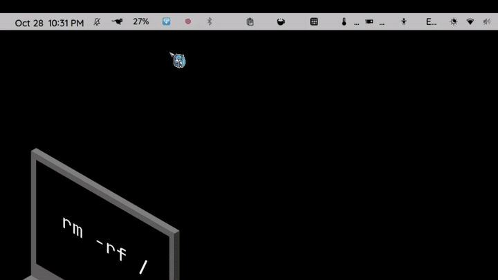

# Blue Archive Desktop Pet

Animated 3D Blue Archive students that walk around your desktop. Written in Python with
Qt (PySide6) and OpenGL (moderngl). Runs on **Linux** and **Windows**.

Every character and outfit on [bluearchive.wiki/wiki/Models](https://bluearchive.wiki/wiki/Models)
is available. That's **145 characters and 289 models**, all fully animated with the
in-game cafe animations (idle, walk, reaction, being picked up and more).

## Demo

[](BApet.mp4)

The preview runs at 2× speed. Click it for the full 50-second video ([`BApet.mp4`](BApet.mp4)).
(Animation lags because the video was taken whilel virtual machine was running in the background)

## Features

- Real 3D rendering of the original glTF models. Skinning, facial morphs and cubic-spline
  animation run on the GPU, with the wiki viewer's unlit look and toon outline.
- Pets wander around the screen and turn to face the way they're walking. When they stop
  they turn back toward you.
- **Drag** a pet to pick it up (it plays the pickup animation). **Click** it to make it react.
  **Right-click** it for options.
- Three movement modes: float anywhere on the desktop, walk along the taskbar (with gravity),
  or stay still. You can also pin a single pet with *Stay Here*.
- Run several pets at once (up to 30). Each pet has its own size and outfit, and any of its
  animations can be played from the menu.
- Models download on demand from the wiki's CDN and are cached locally. Each download is
  checked against the repository's git SHA-1, and a second mirror is tried if the first
  one fails. *Download All* (about 1.7 GB) makes the app work fully offline.
- *Refresh List* re-reads the wiki, so newly added students show up without an app update.
- Clicks pass through the transparent parts of a pet's window. It doesn't steal focus and
  doesn't appear in the taskbar.
- Tray icon, settings dialog, start at login, single instance (launching the app again
  opens the *Add Pet* dialog), saved pet positions, crash logging and a clean shutdown on
  logout or SIGTERM.

## Install

### Windows
Download `BlueArchiveDesktopPet-<version>-windows-x64.exe` and run it. No installer is
needed. To start it with Windows, open **Settings → Start when I log in**.

### Linux
```sh
tar xzf BlueArchiveDesktopPet-<version>-linux-x86_64.tar.gz
cd BlueArchiveDesktopPet-<version>-linux-x86_64
./install.sh            # copies to ~/.local/bin and adds a menu entry
# or just run ./BlueArchiveDesktopPet
```
Requirements:
- An X11 session or Wayland with XWayland. The app switches to XWayland automatically,
  because Wayland doesn't let apps position their own windows.
- A compositing window manager, which is the default on GNOME, KDE, Cinnamon and Xfce
  with compositing turned on. Without one, transparency can't work.
- OpenGL 3.3.

On GNOME the tray icon needs the *AppIndicator* extension. Without a tray, everything is
still reachable from the pet's right-click menu.

## Usage

| Action | Result |
| --- | --- |
| Drag with the left button | Pick the pet up and move it |
| Click | Reaction animation |
| Right-click | Pet menu: change character or outfit, play an animation, size, stay here, duplicate, remove |
| Tray icon click | Add Pet dialog |
| Tray menu | Add pet or random pet, pause movement, hide pets, model library, settings, quit |

Command line:
```
BlueArchiveDesktopPet [--add "Hina"] [--add "Airi (Band)"] [--debug] [--reset] [--version]
```

### Where things are stored

| | Linux | Windows |
| --- | --- | --- |
| Settings | `~/.config/bluearchive-desktop-pet/settings.json` | `%APPDATA%\BlueArchiveDesktopPet\settings.json` |
| Models (default) | `~/.local/share/bluearchive-desktop-pet/models` | `%LOCALAPPDATA%\BlueArchiveDesktopPet\models` |
| Logs | `~/.local/share/bluearchive-desktop-pet/logs` | `%LOCALAPPDATA%\BlueArchiveDesktopPet\logs` |

You can change the models folder in Settings.

## Building from source

```sh
python3 -m venv .venv && . .venv/bin/activate
pip install -r requirements-dev.txt
python -m bapet                 # run from source
python -m pytest                # tests
```

### Linux binary
```sh
scripts/build_linux.sh
# -> dist/linux/BlueArchiveDesktopPet  and  dist/BlueArchiveDesktopPet-<ver>-linux-x86_64.tar.gz
```
The binary works on distributions with the same or a newer glibc than the build machine.
Build on the oldest distribution you want to support (CI uses Ubuntu 22.04).

### Windows binary
Native build on Windows with Python 3.12 installed:
```powershell
powershell -ExecutionPolicy Bypass -File scripts\build_windows.ps1
```
Cross-build from Linux with Wine. This downloads the official CPython NuGet package into
a private Wine prefix, `~/.cache/bapet-wine-build`:
```sh
scripts/build_windows_wine.sh
# -> dist/BlueArchiveDesktopPet-<ver>-windows-x64.exe
```
The resulting exe targets Windows 10 1903 or later. It can't be *run* under Wine, because
Qt 6 needs the Windows system ICU library (`icuuc.dll`), which Wine doesn't provide.
Test it on real Windows.

### CI
`.github/workflows/build.yml` builds both platforms on every push. Pushing a `v*` tag
publishes a GitHub release with the Linux tarball and the Windows exe attached.

### Updating the bundled model list
```sh
python tools/update_catalog.py   # re-scrapes the wiki + GitHub tree -> bapet/catalog.json
```

## Project layout

```
bapet/
  app.py        controller, tray, single instance, entry point
  pet.py        pet window, behaviour state machine, input
  renderer.py   moderngl off-screen renderer (GPU skinning, outline, MSAA)
  gltf.py       glTF/GLB loader, animation sampling and baking
  models.py     downloader (mirrors, checksum) and model manager
  catalog.py    wiki/GitHub model catalog
  dialogs.py    model browser, settings, about
  config.py     settings, paths, logging
  autostart.py  start at login (registry Run key / XDG autostart)
tools/          catalog + icon generators
scripts/        build scripts
packaging/      PyInstaller launcher, Windows version info, Linux installer
tests/          pytest suite
```

## Troubleshooting

- **Black box around the pet (Linux):** turn on compositing in your window manager.
- **"OpenGL 3.3 is required":** update your graphics drivers. On Windows the app falls back
  to the bundled Mesa software renderer if it can.
- **A pet is stuck on "Failed to load":** click it, or right-click → *Retry Loading*.
  Details are in the log file (Settings → *Open Log Folder*).
- **High CPU use:** lower the frame rate in Settings. 15–24 FPS still looks smooth.

## Legal

This is an unofficial fan project and isn't affiliated with NEXON Games or Yostar.
Blue Archive, its characters and the 3D models are © NEXON Games Co., Ltd. / Yostar.
The application doesn't ship any game assets. Models are downloaded at runtime from the
public [BlueArchiveModels](https://github.com/lihaohong6/BlueArchiveModels) repository
that the Blue Archive Wiki uses. The application's source code is MIT licensed (see `LICENSE`).
